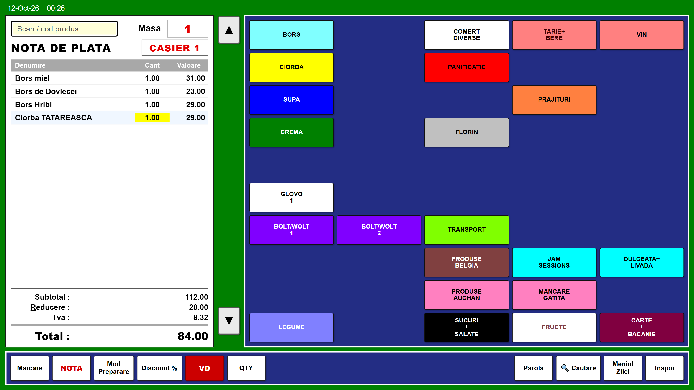
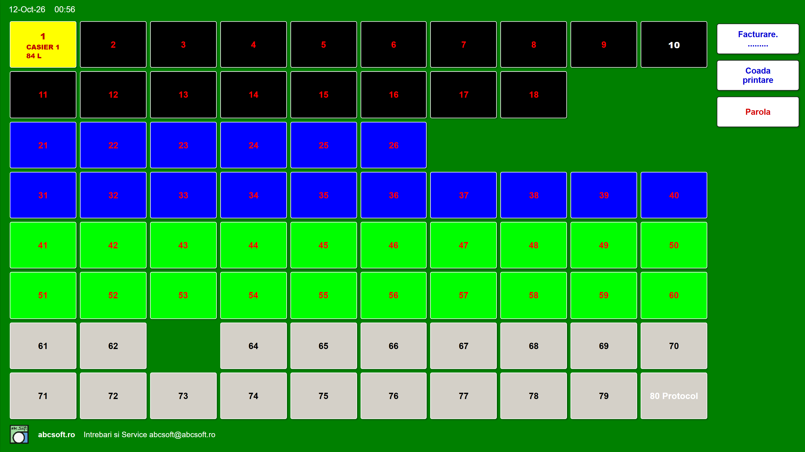
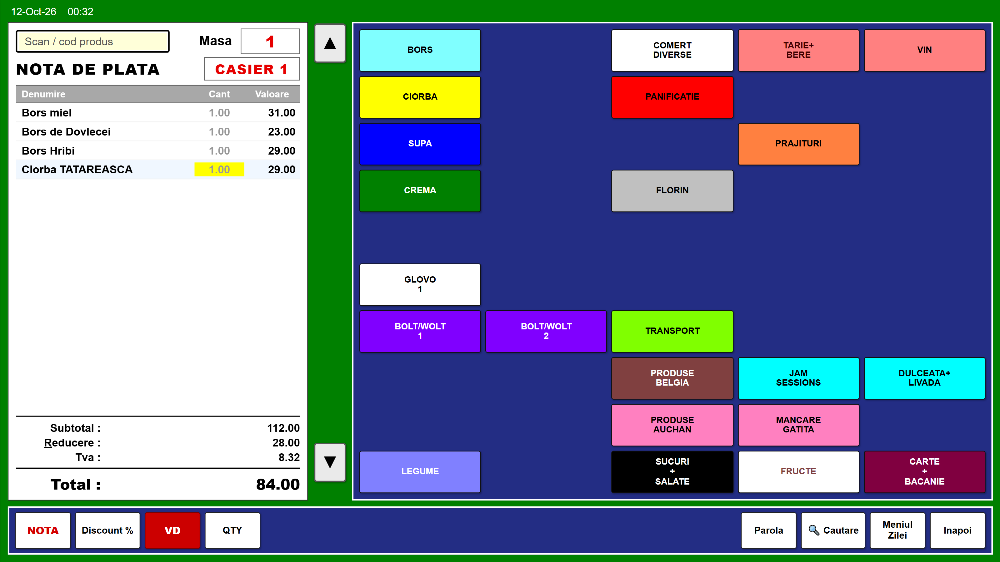
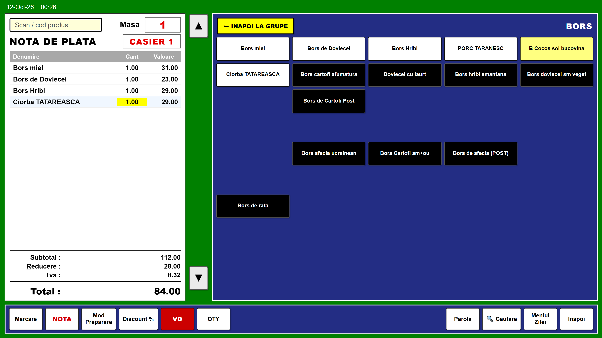
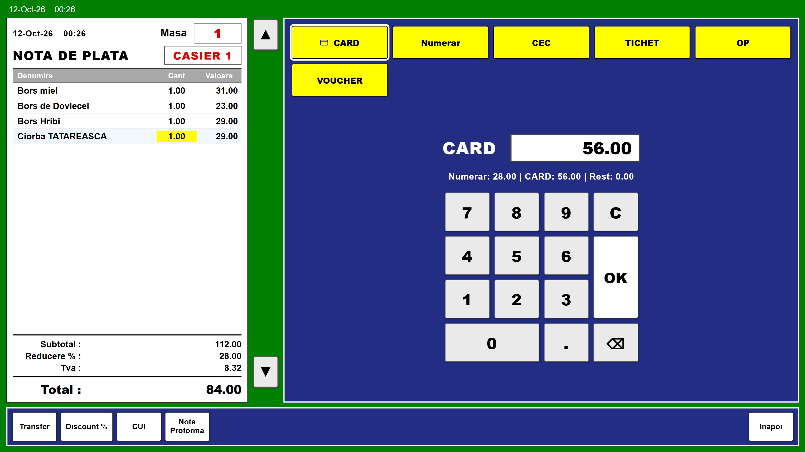
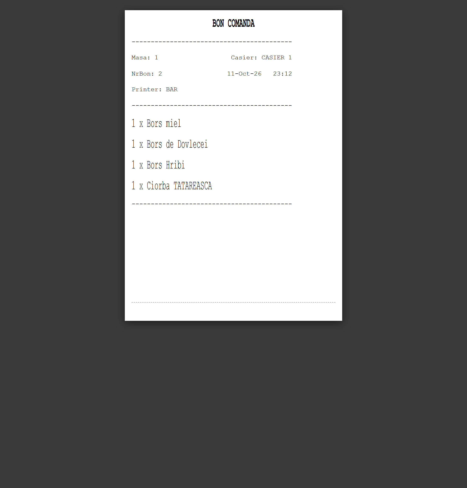
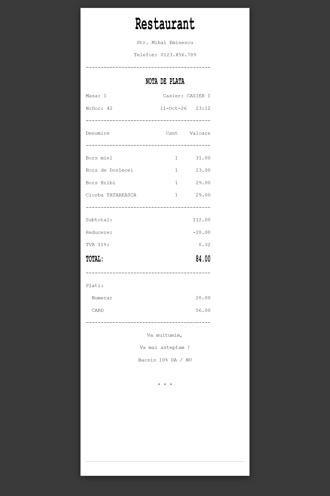
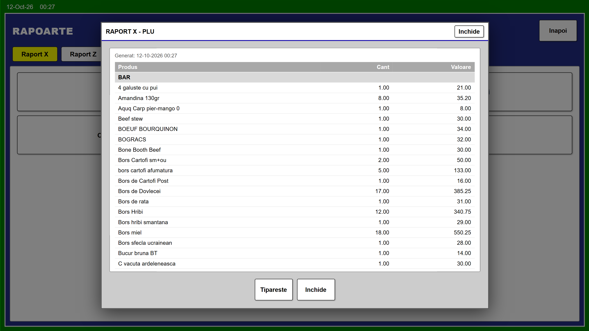
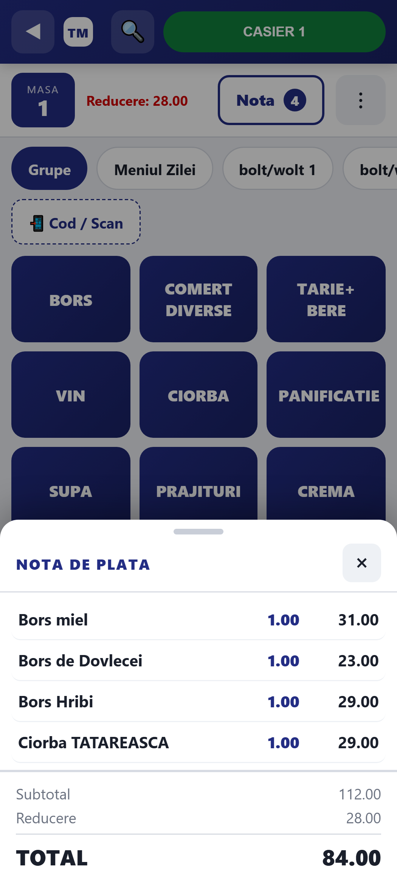
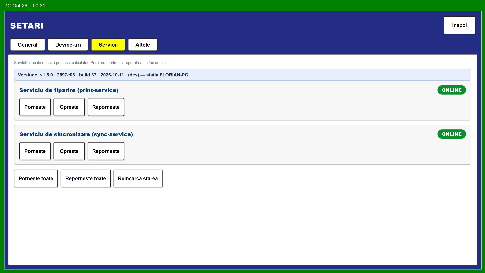

# TableManager 1.5.0

### POS complet pentru restaurante și fast-food — instalare automată, fiabilitate în exploatare, fără dependențe grele.



TableManager gestionează **mesele, bonurile, ospătarii, meniul, discounturile, stornările, plățile** (inclusiv plata cu cardul prin terminal bancar) și **tipărirea la bucătărie / bar / notă fiscală**, plus rapoartele X și închiderea Z.

Aceeași aplicație rulează în **două moduri** — **Restaurant** (comandă la masă) și **FastFood** (vânzare rapidă la tejghea) — alese dintr-o singură setare. Este rescrisă de la zero pe tehnologii moderne și ușoare, cu **cozi durabile**: *nu se pierde nicio comandă și niciun bon*.

`Versiune 1.5.0` · `PHP 8.3 + MSSQL` · `Fără build step` · `Windows + Apache` · `Modul mobil inclus`

---

## De ce TableManager?

- **Instalare automată „într-un pas"** — un installer dedicat configurează totul pe un Windows 11 curat: Apache, PHP, SQL Server Express, Python, serviciile și scurtăturile.
- **Actualizare la un click**, cu **versionare** (versiune + build + commit), **backup automat** înainte de update și posibilitatea de a ști exact ce versiune rulează pe fiecare stație.
- **Nu pierde niciodată o comandă sau un bon** — cozi durabile cu reîncercare automată; imprimanta sau serverul pot fi oprite, nimic nu se pierde.
- **Funcționează offline** și exportă către server de îndată ce revine conexiunea.
- **Fiscal + POS bancar + tipărire bucătărie integrate** — nu module externe scumpe.
- **Un singur produs, două moduri:** Restaurant și FastFood.
- **Modul mobil inclus** (tabletă/telefon), fără costuri suplimentare.

---

## Două moduri de operare: Restaurant și FastFood

Alegerea se face din **Setări → General** (`TipVanz`). Aceeași bază de date, același meniu, aceeași interfață de programare.

### 🍽️ Restaurant — comandă la masă



- Hartă de mese (80 de locuri), bon deschis pe masă, proprietar pe ospătar.
- **Bon de comandă** către bucătărie/bar, pe secții, cu numerotare proprie a bonurilor de secție.
- **Notă de plată**, **notă proformă**, **transfer produse** între mese și **mod preparare**.

### 🍔 FastFood — vânzare rapidă la tejghea



- Fără hartă de mese — aplicația pornește direct în ecranul de vânzare.
- Fără bon de secție, fără notă proformă, fără transfer, fără mod preparare (ascunse automat).
- La închidere se emite **doar bonul fiscal**; totalul și restul apar în panoul de vânzare.

> Un singur proiect, două fluxuri — nu două aplicații de întreținut.

---

## Funcționalități

### Operare sală
- **Mese și bonuri** — 80 de mese, deschidere/închidere bon, proprietar pe ospătar (un ospătar nu poate intra pe masa altuia).
- **Meniu** — grupe și produse cu prețuri, culori, fonturi și dimensiuni configurabile; **Meniul Zilei**.
- **Scanare cod** — caută după cod de bare sau cod produs.



### Comenzi & bucătărie
- **Bon de comandă pe secții**, cu numerotare proprie a bonurilor de secție (contor dedicat, resetat la raportul Z).
- **Mod preparare** — text atașat unei linii (ex. „fără ceapă"), care nu afectează totalul.

### Discount & stornare
- **Discount** pe linie sau pe bon, procentual sau valoric, distribuit corect pe cotele de TVA.
- Trei moduri configurabile: complet (produs/subtotal, procent/valoare, cu popup) · doar procent la subtotal · procent fix la subtotal, aplicat direct.
- **Stornare (VD)** — anulare a liniilor deja trimise, cu parolă de manager și motiv; cantitățile nu pot fi depășite; liniile netrimise se anulează direct.

### Plăți
- **Split** pe mai multe forme de plată (numerar, card, tichet etc.), cu rest afișat.
- Setarea **plată combinată** (DA/NU): la *NU*, ecranul de închidere afișează doar formele de plată (fără numpad), iar un click pe o formă închide nota integral.



- **POS bancar (terminal card)** — când nota are plată pe card și `tblSet.PoSbanca = 1`, aplicația comunică sincron cu terminalul printr-un driver extern, cu timeout de 190 s, dialog **Cancel / Retry / Ignore** la refuz (Cancel păstrează nota deschisă, Ignore o închide oricum) și **audit** al fiecărei încercări (sumă, TRX_ID, status, mesaj) în `tblPosBancaLog`.

### Casa de marcat (fiscal)
- Fișierul de comenzi pentru driverul fiscal, generat pentru **FiscalWire** (`.inp`) sau **FiscalNet** (separator `^`), în funcție de `tblSet.TipCasaMarcat`.
- **CUI (cod fiscal client)** — popup cu tastatură dedicată, validat cu cifra de control ANAF și trimis pe bon.

### Tipărire
- **Coadă durabilă de tipărire** — bon de comanda pe secții, nota de plată, nota proformă și rapoarte.
- Destinațiile fizice ale fiecărei secții (Windows raw, rețea :9100, fișier, preview) se configurează din aplicație, cu **test de tipărire**; modificările se aplică instant (hot-reload).
- **Emulator de bon inclus** — previzualizare fără hardware.





### Rapoarte și închidere
- **Rapoarte X** — PLU, Grupe, Secții, Casieri, General și **Note** (bonurile închise din sesiune, cu detaliul fiecărei note).
- **Închidere Z** — arhivare și golire atomică a zilei, cu raport General Z plus rapoartele selectate.



### Administrare din interfață
- Setări, grupe, produse, secții, mese, ospătari, moduri preparare, parole, cote TVA, imprimante pe secții, forme de plată, antet, notă, conectare server și sincronizare produse — toate editabile direct din aplicație.

### Modul mobil
- Pagină dedicată pentru tabletă/telefon (`mobile.html`) pentru marcarea meselor, independentă de POS-ul desktop, dar folosind aceleași API-uri.



### Multi-stație & integrare
- **Export către server** — la închiderea fiecărei note se scrie o comandă `EXEC EmitBon_Ext_NOU` (Restaurant) / `EmitBon_Ext_2` (FastFood) într-o coadă durabilă; un serviciu Python o execută pe serverul din `tblConectare`. Dacă serverul e oprit, comanda se reîncearcă **la infinit**, cu backoff.
- **Import produse/grupe la pornire** — sincronizare de pe serverul extern prin procedura `dbo.ImportProd`. Se pot importa una sau mai multe magazii (`tblSet.MagID`, ex. `1,2`); la produsele prezente în mai multe magazii câștigă prima din listă.

---

## Fiabilitate și siguranță

- **Tranzacții atomice** pentru operațiunile critice (închiderea bonului, marcarea, închiderea Z): un bon sau o zi nu poate rămâne pe jumătate procesat(ă).
- **Cozi durabile** pentru tipărire și export — joburile sunt persistate în baza de date și reîncercate automat, deci o imprimantă offline nu pierde și nu blochează nicio comandă.
- **Interogări parametrizate** — elimina injectia SQL.
- **Parole pe roluri** — programare, rapoarte, stornare, discount și ieșire; autentificare pe fiecare ospătar, cu blocare.
- **Credențiale în fișier local**, ignorat de git.
- **Backup automat** înainte de fiecare actualizare.

---

## Instalare & actualizare

- **Installer automat** (repo separat `TableManager-Setup`): pe un Windows 11 gol configurează Apache + PHP 8.3 + SQL Server 2022 Express + Python 3.12, deploy-ul aplicației, clonarea bazei de date, mediul virtual `.venv`, serviciile și scurtăturile. Dublu-click pe `Setup.bat`; instalarea este idempotentă.
- **Pornire kiosc** — `Pornire-POS-Kiosk.vbs` (fără fereastră DOS) deschide aplicația fullscreen și importă produsele la pornire.
- **Actualizare din aplicație** — butonul **Update** compară versiunea instalată cu GitHub, face backup și aplică automat.
- **Versionare** — fiecare stație știe exact ce rulează: fișierul `VERSION` (ex. `1.5.0`) plus build + commit + dată, vizibile în **Setări → Servicii**, în dialogul Update și programatic prin `api/version.php`. Procesul de release (bump de versiune, `sync.sh`, tag git) este descris în [docs/VERSIONARE.md](docs/VERSIONARE.md).



---

## Tehnologie și avantaje

- **PHP + MSSQL (extensia `sqlsrv`)** — backend simplu, fără framework. Apel direct de proceduri stocate și tranzacții ACID native pentru operațiuni critice; zero layer de abstractizare care să ascundă comportamentul bazei de date.
- **JavaScript și CSS pur (fără framework, fără build step)** — frontend desktop în `js/pos.js`, mobil în `js/mobile.js`. Deploy = editezi fișierul și reîncarci pagina.
- **Aspect scalat pe canvas** — design de bază 1024×768, scalat proporțional pe orice ecran, fără CSS fragil de tip vw/vh.
- **Serviciu de tipărire Python + ESC/POS** — `print-service/` randează bonurile și le trimite nativ către imprimante (Windows raw sau rețea :9100); își deține configurarea și o reîncarcă la cald, cu emulator inclus pentru testare.
- **Rulează pe HTTP** — serviciile își deduc singure URL-ul API din numele folderului de instalare, deci funcționează chiar dacă proiectul este redenumit sau instalat în alt folder direct sub `htdocs`.

---

## Cerințe

- **Apache** cu **PHP** și extensia **`php_sqlsrv`** încărcată.
- **Microsoft SQL Server** (baza de date configurabilă în `api/db.local.php`).
- **Python 3.12** (Windows) pentru componentele Python (`print-service/`, `sync-service/`, `import_server_grp_prod.py`) — opțional, doar dacă folosiți una dintre ele. Toate rulează **dintr-un mediu virtual comun** `.venv` din rădăcina proiectului, creat o singură dată cu `setup-venv.bat` (dependințele — `pyodbc`, `pywin32`, `pyserial` — sunt în `requirements.txt`). Este nevoie și de un **ODBC Driver for SQL Server** instalat. Mediul virtual este obligatoriu: fără el, pornirea kiosc-ului și a serviciilor Python se oprește cu un mesaj care cere rularea `setup-venv.bat`.

---

## Instalare și configurare (manual)

1. Copiați proiectul în directorul servit de Apache (ex. `htdocs/rual`).
2. Reconstruiți baza de date rulând `db/schema.sql` apoi `db/seed.sql` (detalii în [db/README.md](db/README.md)).
3. Configurați conexiunea: copiați `api/db.local.example.php` în `api/db.local.php` și completați serverul, baza, utilizatorul și parola.
4. (Opțional, dar obligatoriu dacă folosiți componentele Python) Rulați `setup-venv.bat` din rădăcina proiectului: creează `.venv`, instalează dependințele și creează scurtăturile (cele două servicii în `Startup` și `TableManager POS` pe Desktop).
5. (Opțional) Porniți serviciul de tipărire: `print-service/start-print-service.bat` (sau `start-print-service-hidden.vbs`). Ascultă doar pe `127.0.0.1:8756`. Destinațiile se configurează din **Setări → Imprimante secții**, cu butoane de test: fiecare țintă (secție, nota, rapoarte) poate fi pe **rețea** (IP:port) sau **Windows / USB** (imprimantă locală cu driver Windows instalat, marcată `(USB)` dacă e pe port USB). Imprimantele USB sunt accesibile doar pe stația care rulează serviciul de tipărire.
6. (Opțional) Porniți serviciul de export: `sync-service/start-sync-service.bat` (sau varianta `-hidden`). Ascultă doar pe `127.0.0.1:8757` și citește serverul/credențialele din `tblConectare` (ID = 1).
7. (Opțional) Folosiți `Pornire-POS-Kiosk.vbs` pentru a deschide aplicația în mod kiosc fullscreen, fără fereastră DOS.

---

## Reconstrucție bază de date

Structura bazei de date și datele de referință sunt publicate în directorul `db/`:

- `db/schema.sql` — tabelele, indecșii, constrângerile, cheile străine și procedurile stocate.
- `db/seed.sql` — date de referință minime plus un meniu demo (fără date reale).

Pașii sunt: rulați `db/schema.sql`, apoi `db/seed.sql`, apoi configurați `api/db.local.php`. Instrucțiuni complete: [db/README.md](db/README.md).

---

## Backup bază de date

Backup planificat al bazei de date MSSQL, independent de aplicație (nu depinde de un browser deschis):

- `tools/backup-db.ps1` — face un backup **full** (`BACKUP DATABASE ... WITH INIT, CHECKSUM`), îl **verifică** (`RESTORE VERIFYONLY`), șterge backup-urile mai vechi de **14 zile** și scrie un log în `logs/backup_db.log`. Credențialele sunt citite din `api/db.local.php` (aceeași sursă ca aplicația), iar execuția folosește ADO.NET (`System.Data.SqlClient`), fără dependențe suplimentare.
- `tools/backup-db-task.xml` — task Windows Scheduler care rulează scriptul **zilnic la 03:00**, ca **SYSTEM** (fără parolă stocată), cu `StartWhenAvailable` (rulează și dacă stația era oprită).
- `tools/install-backup-task.bat` — montează task-ul (rulează ca Administrator): își deduce folderul proiectului, rescrie calea din XML și apelează `schtasks /Create`.

Implicit, backup-urile se scriu în `C:\ABCSoft\Data\backup`, cu numele `<BazaDeDate>_<yyyyMMdd_HHmmss>.bak`. Când SQL Server rulează pe aceeași mașină, scriptul creează folderul și acordă drepturi de scriere contului serviciului SQL; dacă serverul e remote, folderul trebuie să existe deja și să fie scriibil pe acea mașină.

**Montare:**

```bat
tools\install-backup-task.bat        :: click dreapta -> Run as administrator
```

sau manual: `schtasks /Create /TN "TableManager\Backup DB" /XML "…\tools\backup-db-task.xml" /F`.

**Rulare manuală / test:**

```bat
powershell -ExecutionPolicy Bypass -File tools\backup-db.ps1            :: backup acum
powershell -ExecutionPolicy Bypass -File tools\backup-db.ps1 -DryRun    :: doar afișează planul
schtasks /Run /TN "TableManager\Backup DB"                              :: forțează task-ul
```

**Restaurare** (după oprirea aplicației), în SQL:

```sql
RESTORE DATABASE [NumeBaza]
  FROM DISK = N'C:\ABCSoft\Data\backup\NumeBaza_20260101_030000.bak'
  WITH REPLACE;
```

---

## Structura proiectului

```
index.html              POS-ul desktop (screens, modale, canvas scalat)
js/pos.js               toata logica POS-ului desktop (stare globala POS_STATE)
css/pos.css             stilurile POS-ului desktop
mobile.html             clientul mobil/tableta (marcare mese)
js/mobile.js            logica modulului mobil (stare globala MOBILE_STATE)
css/mobile.css          stilurile modulului mobil
VERSION                 versiunea human (ex. 1.5.0)
docs/img/               capturile de ecran din acest README
api/                    endpoints PHP (JSON)
  db.php                conexiunea MSSQL (+ db.local.php local, ignorat)
  order_action.php      dispatcher: add_product, close_bill, void_line, apply_discount etc.
  menu.php, get_order.php, get_tables.php
  rapoarte.php          rapoarte X, inchidere Z, printare rapoarte
  print_queue.php       API-ul cozii durabile de printare
  print_common.php      helperi comuni (ensurePrintQueueTable, enqueuePrintJob)
  send_queue.php        API-ul cozii durabile de export catre server (temp_Send_Sql)
  send_common.php       helperi comuni (ensureSendSqlTable, enqueueBillSendSql)
  print_config.php      proxy catre serviciul de printare (citire/salvare config, test)
  pos_banca.php         comunicarea cu terminalul bancar (POS bancar) + audit
  version.php           versiunea aplicatiei (VERSION + build + commit)
  version_common.php    helperi pentru versionare (stare, eticheta, log)
  exit_app.php          inchide browserul POS din parola de inchidere
  sync_products.php     ruleaza procedura stocata dbo.ImportProd (Sincronizare produse)
  ...                   editori de configurare (produse, grupe, mese, tva, kp, fp, etc.)
  sql/z_procedure.sql   procedura stocata de inchidere Z
print-service/          serviciu Python de printare ESC/POS
  server.py, worker.py, escpos.py, emulator.py, targets.py, config.py, config.json
sync-service/           serviciu Python de export catre serverul extern (temp_Send_Sql)
  server.py, worker.py, db.py, config.py, config.json
db/                     reconstructia bazei de date
  schema.sql            structura tabelelor + proceduri stocate
  seed.sql              date de referinta + meniu demo (fara date reale)
Pornire-POS-Kiosk.vbs   lansator kiosc ascuns (fara fereastra DOS) + import produse la pornire
Pornire-POS-Kiosk.bat   lansator kiosc cu fereastra vizibila (aceeasi logica)
import_server_grp_prod.py  import produse/grupe de pe server (dbo.ImportProd)
requirements.txt        dependintele Python (pyodbc, pywin32, pyserial) pentru mediul virtual
setup-venv.bat          creeaza .venv, instaleaza dependintele si creeaza shortcut-urile (o singura data)
tools/create-shortcuts.vbs  creeaza shortcut-urile: serviciile in Startup + POS pe Desktop
tools/backup-db.ps1     backup full al bazei de date (planificat, verificat, cu retentie)
tools/backup-db-task.xml    task Windows Scheduler pentru backup (zilnic 03:00, ca SYSTEM)
tools/install-backup-task.bat  monteaza task-ul de backup (Run as administrator)
.venv/                  mediul virtual Python (creat local, ignorat de git)
sync.sh                 commit + push catre GitHub + regenereaza snapshot-ul de instalare
```

---

## Anexă tehnică

### Casa de marcat (protocol detaliat)

La închiderea notei (`close_bill`), în aceeași tranzacție, se generează fișierul de comenzi pentru casa de marcat și se scrie în coada durabilă de tipărire; serviciul Python îl scrie în `spool/fiscal` și îl **copiază** în folderul monitorizat de driverul fiscal (`tblSet.CaleFisierComenziECR`), de unde casa îl procesează. Dacă folderul nu e disponibil, jobul se reîncearcă cu backoff, deci bonul nu se pierde.

Tipul casei se alege din **Setări → Casa Marcat** (`tblSet.TipCasaMarcat`):

- **FiscalWire** (driver FiscalWire) — fișier `.inp`:
  - `H,1,______,_,__;` antet (fără linie `F` la final, ca în procedura veche);
  - `S,1,______,_,__;NUME;PRET;CANT;1;1;NrTVA;0;0;` vânzare (nume majuscule, trunchiat la 32 de caractere, fără completare cu spații; preț cu 2 zecimale; cantitate cu 3 zecimale; storno = cantitate negativă);
  - `C,1,______,_,__;1;PROCENT;` discount pe linie (procent simplu, ex. `5.00` = 5%);
  - `K,1,______,_,__;RO12345678;` cod fiscal client, înainte de prima vânzare;
  - `T,1,______,_,__;COD_PLATA;;;;;` încasare la o **singură** formă de plată (fără sumă: FiscalWire calculează singur totalul); la mai multe forme de plată se scrie câte o linie cu suma fiecărei forme (`T,1,______,_,__;COD_PLATA;SUMA;;;;`), descrescător după cod.
- **FiscalNet** — fișier `.txt` cu separator `^`:
  - `S^NUME^PRET^CANT^buc^GRTVA^1`, `DV^valoare` / `MV^valoare` pentru discount/majorare, `VS^...` pentru stornare, `ST^` subtotal, `P^COD_PLATA^SUMA` încasare;
  - `CF^RO12345678` cod fiscal client, înainte de prima vânzare.
- **Fisco**, **fprwin** — în curs de implementare.

Codurile de plată se iau direct din `tblFP.FPID` (0 = Numerar, 1 = Card, 2 = CEC, 3 = Tichet, 4 = OP, 5 = Voucher): la FiscalWire se scrie `FPID`, la FiscalNet `FPID + 1`. Grupa de TVA se rezolvă din `tblTVA` după cota liniei (`tblNoteD.TVAc` → `tblTVA.Nr_TVA`).

Implicit, bonul fiscal **nu** afișează discountul și nici stornarea (doar cantitățile și prețurile nete). Setarea `tblSet.BonFiscalDiscStorno = 1` activează modul detaliat.

### Așteptarea răspunsului casei de marcat (FiscalWire / FiscalNet)

Setarea `AsteaptaRaspunsCasa` (Setări → Casa Marcat, implicit **NU**): când este **DA** și tipul casei este **FiscalWire** sau **FiscalNet**, la închiderea notei POS-ul scrie fișierul de comenzi direct în `tblSet.CaleFisierComenziECR` și **așteaptă** până la `AsteptareCasaSec` secunde (implicit 30) confirmarea în `tblSet.CaleFisierRaspunsECR`, înainte de a închide nota:

- **FiscalWire**: fișierul `.nrb` (prima linie `OK;Z=..|NR=..|...|BF=..`) confirmă bonul; `NrBon` (`NR`) și `NrZ` (`Z`) reale sunt trimise mai departe serviciului de export; `CANCELED` sau orice linie cu status `Er` blochează închiderea.
- **FiscalNet**: fișierul de răspuns conține `BONOK=1` + `NRBON=<nr>` la succes, `BONOK=0` + `ERRCODE`/`ERRINFO` la eroare, sau `BONOK=-1`.
- lipsa răspunsului (timeout) înseamnă că nota **nu** se închide; ecranul de plată revine la starea inițială și se poate reîncerca.
- în orice caz de eșec, POS-ul **șterge fișierul de comenzi**, ca driverul să nu tipărească ulterior un bon abandonat; înainte de fiecare trimitere se curăță și fișierele `pos_tm_*` abandonate.
- fiecare eșec se scrie în `logs/fiscal_wait.log`.

### Testare fiscală (mock-uri)

- `tools/mock_fiscalwire.py` (pornit cu `tools/mock_fiscalwire.bat`, din `.venv`) simulează driverul FiscalWire: scrie răspunsurile `.txt`/`.nrb` în folderul configurat (moduri `ok` / `err` / `canceled` / `silent` / `random`) și șterge fișierul de comandă după procesare (se poate păstra cu `--keep`).
- `tools/mock_fiscalnet.py` (cu `tools/mock_fiscalnet.bat`) simulează driverul FiscalNet: scrie răspunsul cu același nume ca al comenzii (moduri `ok` / `err` / `pos` / `silent` / `random`).

---

## Licență

Acest proiect este distribuit sub **GNU General Public License v3.0 (GPL-3.0)**.

Copyright (C) 2026 **Florian Liviu Stefanescu**.

Textul complet al licenței: [LICENSE](LICENSE).

Aplicația este software liber: o poți folosi, studia, modifica și redistribui liber, cu condiția ca orice versiune derivată distribuită să rămână, la rândul ei, sub GPL-3.0 și cu sursa deschisă. Se distribuie fără nicio garanție.

---

© ABCSoft · https://abcsoft.ro
